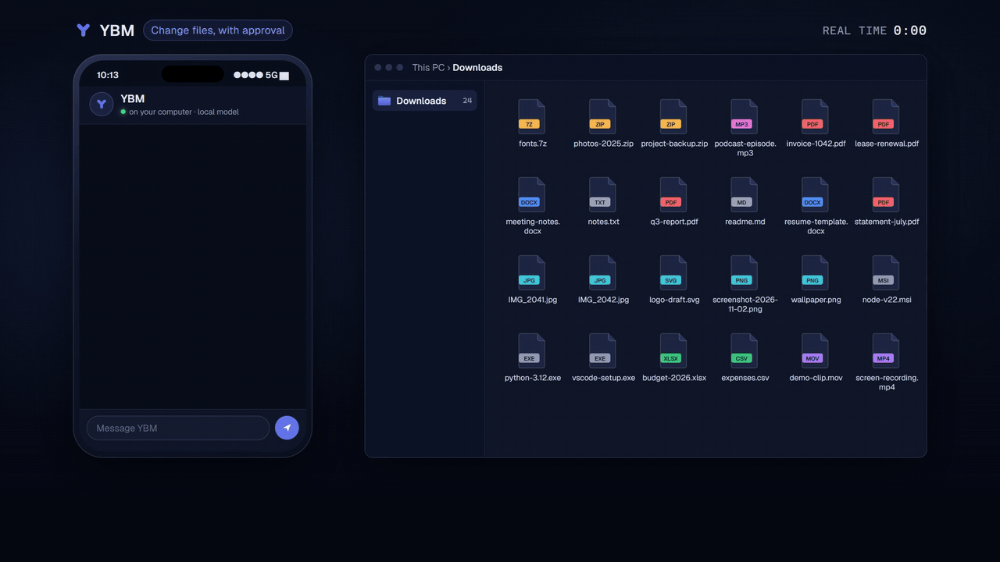
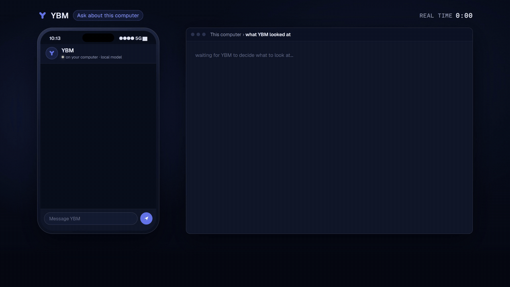
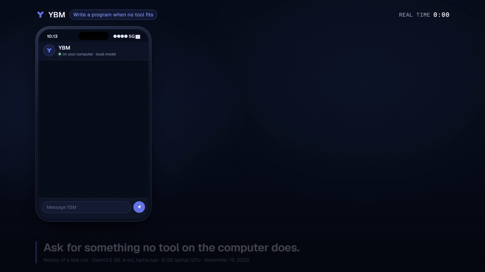

<div align="center">


# YBM

**An assistant for your own computer that runs on a local language model and records what it did.**

[](LICENSE)
[](backend/pyproject.toml)
[](docker-compose.yml)

<a href="https://oneyerge.com/media/ybm-tour.mp4"></a>

<sub>A replay of a real run: Qwen3.5 9B on an 8 GB laptop GPU organizes 24 downloads, stops for an approval, then moves them. The messages, files and clock come from the run's log. <a href="https://oneyerge.com/media/ybm-tour.mp4">Watch the 80-second tour</a>, <a href="https://oneyerge.com/demo/ybm/">try the replays in a browser</a>, or read <a href="docs/demo/README.md">how they are made</a>.</sub>

</div>

YBM is an assistant that runs on your own computer. You send it a request from a web console, Telegram, or WhatsApp, and it works on the files, web pages, and programs on that machine. It uses a language model that you choose. I built and tested it on a small local model, Qwen3.5 9B on an 8 GB laptop GPU, so a task costs no API fees and your files stay on your machine.

A chat assistant answers in a window. YBM acts on this machine: it reads and changes files, opens pages, and runs programs, and it records what it did. I built it because I wanted to message my own computer and have it do the work. It is alpha software. The sections below say what it does, how it asks before it acts, how to try it, what I measured, and what I have not.

## What it does

- **Finds things and answers questions about them.** "How many Steam games do I have?" or "Which paper says when the warranty ends?" It says how thoroughly it looked.
- **Changes files after showing a plan.** Organizing a folder, renaming, moving. It lists the moves, waits for your approval, and writes a receipt. An Undo button on the receipt, or "undo that" on Telegram, moves the files back.
- **Writes a program when no tool fits.** A small web page that does a calculation, or a script that reads five websites and compares them. It runs the program on your machine and gives you the link or the result.
- **Works in a browser and on the desktop.** It opens pages, fills in forms, and reads what is on the screen. Desktop control is Windows only.
- **Remembers.** It keeps facts you tell it and projects with their decisions, across chats. You can list, correct, and delete them.
- **Repeats work.** Saved workflows on a schedule, folder watchers, and small monitors that speak only when something changes.
- **Researches in the background.** A request such as "find all the daycares around me" becomes a job that keeps searching until new searches stop finding anything. It keeps a source for each value and saves a report as Markdown and Word. This is the least finished part.

<p align="center"></p>

<p align="center"><sub>Asked from a phone, it reads the Steam library on the computer: 14 games, about 203 GB, answered in 27 seconds. A replay of a real run.</sub></p>

<p align="center"></p>

<p align="center"><sub>Asked for a tip calculator, it writes the page, starts it on the computer and sends the link, 78 seconds in all. Then the page it wrote is used. A replay of a real run.</sub></p>

[Measured results](docs/MEASURED.md) lists the requests I test with and how many pass.

## How it asks before it acts

- **High-impact tools start off.** File changes, the terminal, the browser, desktop control, installing packages, and Git pushes are each off until you turn them on. File access is limited to the folders you pick.
- **Three levels of asking.** *Ask* checks with you before meaningful choices. *Balanced*, the default, chooses routine details and asks when a missing fact blocks the work. *Autonomous* does not ask, and grants routine approvals itself; each one is recorded as the assistant's own.
- **Two things wait for you at every level.** Anything that spends your money (an order, a payment, a subscription, card details), and any operation with critical risk. For a purchase it prepares everything up to the payment page, then asks once, with the items, seller, total, the last four digits of the card, and the address.
- **An approval covers one operation.** It is bound to the exact request, it expires, and it is used once. The [threat model](docs/THREAT_MODEL.md) gives the details.
- **A receipt for every task.** It lists what the task touched, what ran, what left the machine, and what it is unsure of. Secrets are redacted from output and logs.

Underneath, each task goes through the same stages: plan, approve, execute, verify, receipt. [Architecture](docs/ARCHITECTURE.md) describes them.

## Install

The first start installs what YBM needs, opens the console, and finds a model already available on your machine. It takes about 2 to 5 minutes, not counting a model download; later starts take seconds.

**What you need.** A computer running Windows, macOS, or Linux, and a language model. I tested with Qwen3.5 9B, a 5.7 GB download, on an 8 GB GPU. A smaller model needs less memory, but I have not measured one. Without a GPU, a provider API key works, and your prompts then go to that provider.

**Windows**

1. [Download YBM-Setup.msi](https://github.com/oney-erge/YBM/releases/latest/download/YBM-Setup.msi)
   and leave **Launch YBM now** selected. Windows will say the publisher is unknown, because the installer is not code signed. The release page shows how to verify the file.
2. Or [download Install-YBM.bat](https://github.com/oney-erge/YBM/releases/latest/download/Install-YBM.bat)
   and double-click it. It needs no administrator access or script signing.

**macOS and Linux**

```bash
curl -fsSL https://raw.githubusercontent.com/oney-erge/YBM/main/scripts/install.sh | bash
```

Run `~/ybm/ybm.sh` later. For a source checkout, use `run.bat` on Windows, `./run.command` on macOS, or `./run.sh` on Linux. Every install route and the headless Docker option are in [Install](docs/INSTALL.md).

## Your first task

1. YBM opens in your browser and shows the model it found. It can use a local model through Ollama, LM Studio, or [LocalDeploy](https://github.com/oney-erge/LocalDeploy) (a tool I wrote that picks, downloads, and runs a model for your hardware), or a provider API key you already have. It does not call a paid API just to choose a model. If it finds none, a short wizard lists the local models that fit your hardware and downloads the one you pick, or takes a provider API key.
2. Create a disposable test folder containing a few sample files. File access starts off; select that folder and allow changes after approval.
3. Ask: **"Organize the files in my test folder by type."** Review the plan and approve it. The receipt records what happened. Press **Undo** on the receipt (on Telegram, send "undo that") and approve the move back.

[Using YBM](docs/USING.md) explains the console, approvals, and troubleshooting.

## Choose a model and channel

| Local, no API key | Cloud API key |
|---|---|
| Ollama, LM Studio, LocalDeploy | Anthropic, OpenAI, OpenRouter, Google Gemini, Groq, DeepSeek, Mistral, xAI, Together AI |

A local model keeps prompts and completions on your machine. Other enabled tools, such as web search or HTTP requests, can still contact external services.

The web console is ready after setup. Telegram is optional and uses user and chat allowlists. WhatsApp is optional, text-only, and uses the unofficial Baileys client with a phone-number allowlist. An empty Telegram or WhatsApp allowlist denies all incoming messages.

## Measured results

These are my own results from one laptop with one model, on 19 November 2026. A suite is a fixed list of requests sent to the running assistant, with the outcome checked by code.

| Suite | Passed |
|---|---|
| Everyday requests (32) | 30 |
| Verdict 4, sealed before the work, run once (20) | 15 |
| Ultimate, longer and open-ended requests (14) | 12 |
| Memory (8) | 8 |
| Browser and desktop (10) | 5 to 9 across five runs |

The second row missed my target of 18. [Measured results](docs/MEASURED.md) lists each miss, the speeds, and what I have not measured: other people's machines, macOS and Linux tasks against a real model, runs longer than a day, and any comparison with other assistants.

## Limits

- **Platforms.** Continuous integration starts YBM and tests the backend on Windows, macOS, and Linux, including 16 recorded task scenarios. Almost all of my own use, and every run on a real model, is on Windows. Desktop observation and control are Windows only. Docker cannot reach the host desktop or editor, and can see only mounted paths.
- **Supervision.** At *Ask* and *Balanced* it stops for consequential actions. At *Autonomous* it does not, apart from money and critical operations. It is not a hardened production service. Keep the admin console on localhost unless you understand the authentication and network implications.
- **Small models make mistakes.** A 9B model can misread a request, take a wrong route, or claim a result without a record behind it. YBM checks a claim such as "I created the file" against a recorded write, and it says when it cannot do a task. These checks are imperfect; the measured results list the misses.
- **WhatsApp** uses an unofficial client and carries account risk. Voice transcription is off by default and needs the `voice` extra.
- **Undo covers moves and renames only.** It does not restore a deleted or edited file.
- **Start with a test folder** and review access settings before granting them.

YBM keeps its data in its own folder, and [Install](docs/INSTALL.md#local-data) lists every path. Read the [threat model](docs/THREAT_MODEL.md) before granting access to important files or accounts. See [Security](SECURITY.md) to report a vulnerability.

## Documentation

| Guide | Use it for |
|---|---|
| [Install](docs/INSTALL.md) | Install routes, runtime commands, local data, and WhatsApp setup |
| [Using YBM](docs/USING.md) | Console tour, approvals, undo, and troubleshooting |
| [Capabilities](docs/CAPABILITIES.md) | Tools and their required access |
| [Measured results](docs/MEASURED.md) | What was tested, what passed, and what has not been measured |
| [Architecture](docs/ARCHITECTURE.md) | Components, policy, and task flow |
| [Threat model](docs/THREAT_MODEL.md) | Trust boundaries and residual risks |
| [Roadmap](docs/ROADMAP.md) | Built features, known limits, and planned work |
| [Database inspection](docs/DATABASE_INSPECTION.md) | Inspecting, pruning, and tracing local state |

For contributors: [Contributing](CONTRIBUTING.md), the [plan](docs/PLAN.md) for the work in order, and the [design rules](docs/DESIGN.md) for where each kind of change lives.

If you try YBM, I would like to hear what you asked it and what happened, including when it failed. [Open a discussion](https://github.com/oney-erge/YBM/discussions) or an issue.

MIT licensed.

Built by [Oney Erge](https://oneyerge.com).
