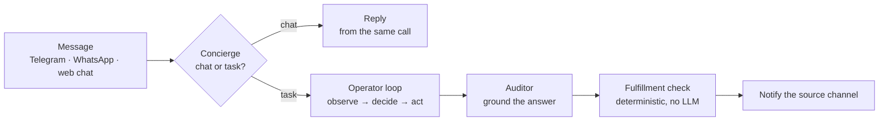
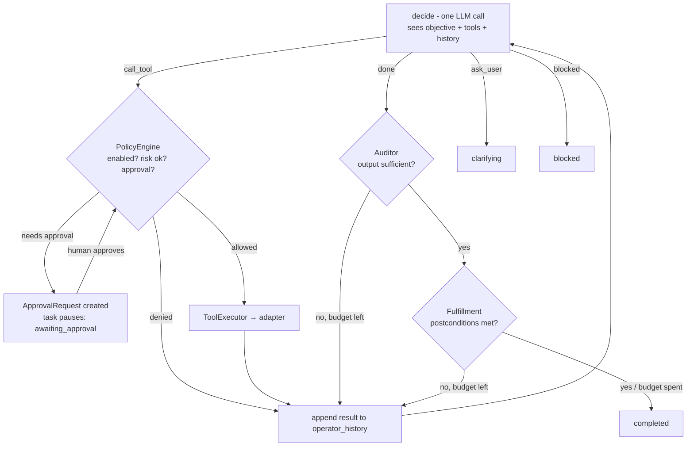
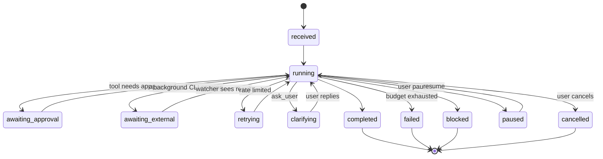
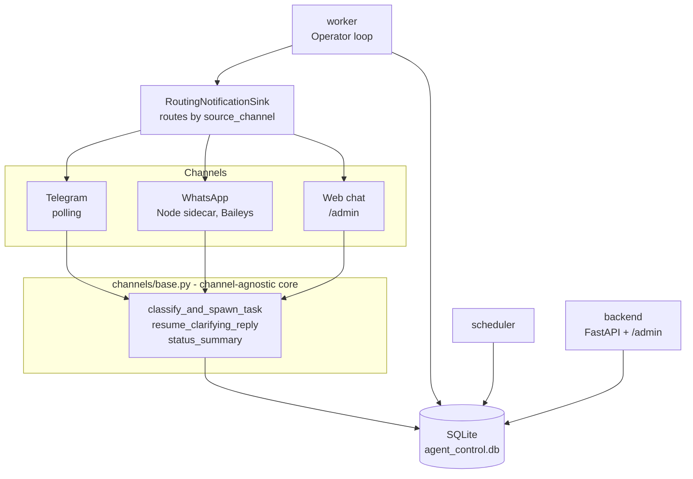

# Architecture

How a message becomes an answer. For *why* it is built this way, see the decision record in
[archive/HISTORY.md](archive/HISTORY.md); for what it can do, [CAPABILITIES.md](CAPABILITIES.md); for how
to use it, [USING.md](USING.md).

## The mental model: three roles, many tools

| Role | Console wording | Calls | Job |
|---|---|---|---|
| **Concierge** | "understands requests" | 1 LLM call | Is this chat or a task? If chat, the reply comes back in that *same* call. May also ask a clarifying question. |
| **Operator** | "does the work" | 1 LLM call per step | The execution loop: observe, decide, act, until done. |
| **Auditor** | "checks the result" | 1 LLM call | Does the raw tool output actually answer the question? Rewrites the final answer so it is grounded. |

A **deterministic** fulfillment check (no LLM) runs last.

The role names are internal. They appear in `schemas.py` (`OperatorDecision`, `OperatorAction`) and in
the recorded scenario fixtures, so renaming them would be a large diff for no user benefit; the console
simply uses the plain-language wording above. All three roles share one model profile by default.
`llm.major_profile` can route heavier work to a different profile, and `llm.fallback_profile` is used
when the primary endpoint is unreachable: connection errors, timeouts, or HTTP 5xx only. A 4xx or a bad
structured response is deliberately *not* failed over, because it would fail the same way against the
fallback and switching models would hide the real problem (`llm/providers.py::_is_unavailability`).



### Optional: a local decision model in front of the Concierge

The Concierge's confidence is not informative (it reports 0.95 to 0.98 for nearly everything), so nothing
downstream can tell a sure call from a guess. A small *decision model* answers the same first question,
"which route is this message?", in one forward pass and returns a probability for every route. LocalDeploy
serves it at `POST /v1/systemone`; `llm/decision.py` asks it. `decision.mode` in `config.yaml` chooses how
much to trust it:

| Mode | What happens |
|---|---|
| `off` (default) | The Concierge decides, as before. Nothing is built or called. |
| `shadow` | The Concierge decides. The decision model's route and probability are recorded beside it as an `intake_decision` audit event, with whether they agree, so it can be judged on real traffic. |
| `cascade` | When the decision model is at least `min_confidence` sure of a route in `cascade_routes`, it decides alone and the Concierge call is skipped. Otherwise, and on any failure or timeout, the Concierge decides exactly as before. |
| `decision` | The decision model decides every message it is at least `min_confidence` sure of, chat and status included. A chat message is answered by the LLM chat responder, a status question by the status path. `coding.agent` stays with the Concierge, which extracts the folder the coding CLI works in. |

In `cascade`, chat and status stay with the Concierge because it writes the reply in the same call, as do
routes whose task may need something only the Concierge extracts (a schedule, a delivery kind). In both
`cascade` and `decision`, a message that arrives while a task is running in the same chat goes to the
Concierge: it may be a correction to that task ("make it 5 not 3"), which only the Concierge recognises.
After a failure the model is skipped for `cooldown_seconds`, so a stopped LocalDeploy costs one timeout, not
one per message. Telegram, WhatsApp and the console chat all route through the same classifier, and the mode
can be changed in the console (Settings, "Message routing"), which also tries a message against both and
shows how often they agreed. The route table in `llm/decision.py` is checked by a test against the Concierge
prompt, so the two cannot drift apart, and the coding agents the tool supports are checked against both texts.
The same call asks a second, yes/no question: does the message only ask what the bot can do? A route says which tool
a request needs, so "can you read PDFs?" looks like document work; when that answer is 0.9 or more the Concierge
decides. See `docs/INSTALL.md` for enabling it.

## The Operator loop

One tick per poll. Every tool call passes the policy gate - this is where approvals happen.



The key property: **a gap never triggers a replan.** It is appended to `operator_history`, and the
next `decide()` sees it in context and chooses what to do. There is no separate recovery planner.

### Decisions `decide()` can return

`call_tool` · `done` · `ask_user` · `blocked`, plus two narrow extras:

- **`call_tools_parallel`** - 2+ *independent* calls via `asyncio.gather`. The batch is pre-flighted
  through the policy engine before anything runs. If any call needs approval, the user gets **one**
  approval listing every such call and nothing executes until they answer, so organising 128 files is
  one question, not 128. Authority does not widen: each listed call has its own approval bound
  byte-for-byte to its exact request, and the batch decision only cascades to those children; a call
  the human never saw still has to ask. There is no retry or background-wait support inside a batch (a
  call that starts a background session fails cleanly while the rest run). Costs one step-budget slot
  per call.
- **`delegate`** - a self-contained sub-task in an isolated inner loop with its own empty history and
  its own budget (`DELEGATE_MAX_STEPS = 6`). Only a one-line summary returns to the parent. Cannot
  recurse, request approval, wait on background work, or ask the user.

Neither is a general replacement for `call_tool`; the Operator prompt says so directly.

### Side effects are not repeated

A call that would create, change, move, delete or send something (the effect table in `tools/effects.py`) is not
run again when the same call with the same input already succeeded in the task. The operator gets the earlier result
back with "Not run again", and if it keeps asking, the no-progress guard stops the task. A small model can miss its
own success: one live run created the same daily schedule nine times, each through its own approval. Reads and
commands are not affected. The no-progress guard (three identical outcomes in a row) also covers calls that name no
operation, such as `{"url": ...}` or `{"query": ...}`. A tool with a single operation uses it when none is named. `schedule.manage` also returns an existing enabled schedule with the same job, cadence and
timezone instead of making a copy.

### References come from what the task already knows

A small model fills a reference with a name it made up rather than one it was given. Two cases are settled before
the call runs. A schedule operation without a `schedule_id` gets the one schedule this task's own results name (with
none or several, the tool still asks for the id). A new schedule's job keeps every URL from the user's message, since
the scheduled run sees nothing else. A file that does not exist, inside a folder the user named, whose
name the user never said, becomes the one file with that extension in that folder. The final answer names the file
that was read where it names a made-up one beside it. When the task resumes after a question, the objective carries
the question as well as the answer, and asking an answered question again is refused with the answer. A question
that still comes after two refusals, once the request's work is verifiably done, ends the task with what it changed
and the question as a note, instead of pausing on the user. That answer is copied from results, so it is not audited.

### Reads are not repeated, and an option to show fewer tools

A read that already succeeded in the task, with nothing written since that could change its answer, is not run again
(`filesystem.manage` reads, `document.manage` reads, `knowledge.search`). The model is shown the earlier result and told to
finish from it; if it asks a third time and the request needs nothing more (no file to write, nothing to send), the task
finishes with that result instead of ending blocked. Browsers, screenshots, HTTP, searches and task status are never
treated as repeats, since asking again can be the point.

`operator.scope_tools: true` narrows the tool catalog to the tools the request's route needs (`orchestration/tool_scope.py`;
a file request sees the file, document, delivery and code tools). Every registered tool still runs if the model names it
and a task with two failed or rejected steps gets the full catalog back. It is off because it did not help when
measured: on 72 recorded steps Qwen3.5-9B scored 46% with it and 49% without (inside the noise).

`operator.constrain_calls` (on by default; `false` turns it off) holds the Operator's reply to one JSON schema in which every tool call is a real tool, a real
operation and that operation's own arguments (`tools/call_schema.py`, built from the tool definitions so it cannot drift from
what `ToolDefinition.validate_input` checks). The local server enforces it while the model writes, so a call such as
`schedule.manage` with `task_name` where `objective` is required, a tool called `filesystem`, or an operation left out cannot
be produced; on the local Qwen3.5-9B about half the failed requests since 10/25 had such a call. It applies to local servers
only: a hosted profile keeps the plain schema, and a server that refuses the strict one (an older LocalDeploy counts the schema as
prompt text) gets the plain one for that call. The reply is still validated as an OperatorDecision and every tool still
validates its own input.

**When a task is stuck or out of steps.** A call that returns the same result three times, a read the model keeps repeating, and the
step budget running out with nothing left to repair each end the same way: once, a check entry tells the model to answer with what it
has or ask one question (with `operator.constrain_calls` its next reply can only finish, ask or stop), and a tool call after that is
not run. What it answers goes through the usual audit and fulfillment checks; a model that refuses the offer ends the task as before
(blocked, or finished with the result it already read).

**Answers are checked against what the task read.** Before a `done` reaches the user (`operator.verify_numbers`, on by default; one
send-back per task, `orchestration/number_check.py`): an email address or web link that the request, the tool results and the
remembered facts never held is flagged ("do not make up values"), and for a request that asks for a calculation a result-sized number
that no tool produced is sent back to be calculated with `code.interpreter`. The local model once answered a lookup with an email
address that was not in the file.

### Where the operator's rules live

The worker's tick used to hold every rule about the model's habits inline (thirty lines of `if`, then fourteen rewrites in a row, then
four checks on the answer), and the order of them mattered without saying so. Each kind is now one small module with the order written
once, and the worker only calls them:

| Module | What it decides | Reads |
|---|---|---|
| `orchestration/request_facts.py` | What the request says: that it deletes, moves, adds to a file, changes one, wants the newest, asks to be asked first, names a coding agent, asks what a document is about, holds URLs. Each fact is read from one text, the same text it always came from (the user's own words, or those plus the objective the concierge wrote). Five of them (deletes, moves, changes, asks about a document, tallies) are only believed when the decision model agrees: the pattern takes "do not delete anything" for a delete, and one yes/no question on the CPU, asked once before the task's first step and only for the facts the words matched, says no. A model that is down leaves the word. | the task |
| `orchestration/call_policy.py` | What happens to a tool call before it runs: a refusal on the call as written, canonical form, a refusal on the canonical call, then the labeled rewrites in `REWRITES`, in order. A refusal comes back as a `Refusal`; the worker writes it into the history because it owns the repositories. The rules themselves are in `call_rewrites.py`. | the call, the history, the tool definitions |
| `orchestration/answer_checks.py` | What a script can find wrong in a `done` answer, in the order of `CHECKS`: a value no tool produced, a sum that does not add up, a quotation nothing contains, a receipt that does not match the request. The first failing check returns a `Pushback` (one history entry and any metadata) and the model is sent back with it; each check says how often it may speak. | the answer, the history |
| `orchestration/check_entries.py` | The names of the pseudo-entries a check appends to the history (`_number_check`, `_strategy_check`, ...), which the step budget does not count. | |

None of them touches storage, runs a tool or calls a model, so each is tested on its own (`tests/test_request_facts.py`,
`tests/test_call_policy.py`, `tests/test_answer_checks.py`). The move out of the worker changed no behavior: the same recorded
scenarios, the same frozen end-to-end suites. To add a rule, add it to the list where it belongs, with a test, not a branch in the tick.
What follows the checks (the Auditor's grounding pass, fulfillment, the voice pass) stays in the worker, which owns the model calls.

### How the worker is laid out

`orchestration/worker.py` held the tick, every stage of it and a thousand lines of helpers in one 4,100-line file. The tick is still there
(`TaskWorker._process_operator_loop`) and the worker keeps the part only it can own (claiming a task, the loop, the transitions); the rest
lives in the module of the stage it belongs to, with the code unchanged. `TaskWorker` is composed of the stage classes, and the helpers are
plain functions in modules named for what they read.

| Stage class | Module | What it does |
|---|---|---|
| `PlanningStage` | `planning.py` | before the first step: the notes about the request, whether it is a project, the parts of a big one |
| `GuardStage` | `guards.py` | between the model's decision and the world: refusals, the ladder of next steps, the offers to finish or hand over |
| `ApprovalStage` | `approvals.py` | asking the person, for one call or a batch, and what follows their answer |
| `DelegationStage` | `delegation.py` | independent calls in parallel, and a sub-task in an inner loop |
| `ExternalStage` | `external.py` | work that finishes somewhere else or later: a coding agent, a usage limit, an uncertain result |
| `RecordsStage` | `records.py` | what happened, written down: model usage, model calls, tool results |
| `ReplyStage` | `reply.py` | telling the person, and what is remembered of a finished task |
| `LearningStage` | `learning.py` | after a task: what could be kept, offered in the chat |

| Helpers | What they read |
|---|---|
| `recovery.py` | a task that was running when the worker stopped |
| `asking.py` | when a question to the person is needed, and when it is not |
| `task_record.py` | a task's own history, results, effects and evidence |
| `repeats.py` | calls and reads that were already done |
| `finishing.py` | how a task ends |
| `grounding.py` | putting the final answer back in line with what was read |
| `replay.py` | replaying a saved workflow |
| `claims.py` | what an answer says it did, against what the record shows it did |

A name that another module needs is public in its module (`redundant_read`, not `_redundant_read`); one that only its module uses stays private.

### Answers are checked against what happened

`claims.py` reads the sentences of an answer that say something was done to the world (a file written or moved, something deleted, a message
sent to someone else, something installed, something paid for) and looks for the record that backs each one. Payment is never backed: this
assistant does not pay. `answer_checks.py` sends the model back once with the sentence and what is missing; the end-to-end suites use the
same function as a test of the whole system, so what is measured is what is protected.

### Abilities: one index of what it can do, could do, and cannot do

Everything the assistant can use was listed by its own code in its own format: the tool catalog (`tools/spec.py`), the skills section
(`tools/skills.py`), the MCP summary (`tools/mcp_client.py`), saved workflows (a table), kept scripts (skill files named `helper-...`).
So "is there anything that can do this?" had no single answer, and a tool that was switched off, a model that could be loaded, or the plain
fact that something cannot be done here was invisible to the model that needed to know. `abilities/` is that one answer.

| Module | What it is |
|---|---|
| `abilities/model.py` | `Ability`: one record for a tool, MCP tool, skill, kept script, workflow, coding agent, local model or known gap. A name, what it is for, its group, its state (`ready`, `disabled`, `installable`, `needs_access`, `unavailable`), what it would take to make it ready, how to call it in the terms of the tools that already exist, and what to say if it cannot be used. It is data about a capability, never a second way to run one. |
| `abilities/sources.py` | Reads each place a capability lives, as it is now, and builds the index. A tool says what it is for next to its own definition (`ToolDefinition.group` and `provides`); a skill, an MCP server or a workflow needs no code to appear. |
| `abilities/gaps.py` | What this assistant cannot do (paying for an order, acting in the physical world) as `unavailable` records with the honest answer and the nearest thing that can be done. Adding one is adding a record, not a branch in the worker. |
| `abilities/index.py` | Finds the records that fit a request by shared words (BM25 over name, what it provides, summary and detail), with no model call. |
| `abilities/context.py` | What bears on a request and is not already in the Operator's prompt, shortlisted by words and confirmed by one yes/no question to the decision model (`DecisionModelClient.yes_no`). Rendered once before the task's first step; a request that matches nothing adds nothing. |
| `tools/abilities.py` | `ability.search`: the Operator's way into the index when nothing in front of it fits (`search`, `describe`). It only reads: making something ready is done with the tools that already do it, each behind its own approval. |

It is off in the code's defaults (`abilities.enabled: false`) so that a recorded scenario fixture, keyed on the exact text of the Operator's
prompt, is not broken by a new tool line; `config.example.yaml` turns it on. The "cannot place orders" rule that used to live in the ladder
(`money_hint`, `RequestFacts.spends_money`) is now the `gap:commerce.order` record: the same words said once, from data, found by the
request instead of by a pattern. A rule that is a fact about the world belongs here as a record; one about a tool's contract belongs in the
tool; one about checking an answer belongs in `answer_checks.py`; one about a procedure belongs in a skill.

### Plans: goals too big for one task

A task runs the Operator loop for twelve steps and ends. "Build me a small drone with a language model in it" is a project: some steps the
assistant does (research, a parts list, the code), some only the user can do (buy, assemble, test), some need something from the user first
(an account, a decision). `plans/` gives that a shape that survives restarts and waits for people.

| Module | What it is |
|---|---|
| `plans/model.py` | `Plan` and `PlanStep`: a goal, and steps in order, each with an owner (`ybm`, `user`, `access`), what it needs, what it depends on, and where it stands. A plan is proposed, active, paused, done or cancelled. |
| `storage/repositories.py` `PlanRepository` | Plans and steps in two tables; `claim_step` moves a pending step to running for exactly one of several workers. |
| `tools/plan_manage.py` | `plan.manage`: the Operator drafts a plan (`create`), looks at it (`show`), changes it as the user says (`add_step`, `update_step`), and starts, pauses or cancels it (`set_status`). It checks that the plan is a plan (1 to 20 steps, owners, dependencies that point backwards) and never runs a step. |
| `plans/runner.py` | Moves started plans forward on every worker pass. A step of the assistant's becomes an ordinary task (same loop, tools, approvals, checks); a step of the user's becomes a question with its own buttons. It keeps no state: each pass reads the database, so a restart or two workers cannot lose or repeat a step. One step at a time. |
| `plans/card.py` | The plan as a message with the buttons that fit where it stands (Start and Cancel; Pause and Cancel; Continue and Cancel). The card goes under the answer of the task that drafted or changed a plan, and is redrawn after a tap. |
| `plans/planner.py`, `plans/stage.py` | The planner: one model call with its own instructions that drafts the steps (with owners) from what the user said and from what the assistant can and cannot do, or asks the one question it cannot do without, once, with options that become buttons. A skill that says `route: plan` (and a yes/no question for `when:`) sends a request it is confirmed for to the planner before the Operator's first step: the worker completes the task with the plan (its card shows in the chat) or makes it a clarifying task. A planner that fails leaves the request to the Operator, which can call the same planner through `plan.manage create`. |
| `plans/context.py` | When a plan is open in a chat, a few lines in the prompt of a task in that chat say so, so "how is it going" and "change step 3" mean that plan. |

A step waiting on the user is a clarifying task that does not take whatever they say next: it is answered by its buttons, or by typing the
words they offer ("done", "skip"), and it does not expire after a day the way a question about one task does. The skill `Plan a project`
(`skills/starter/`) tells the Operator how to draft one: ask one question first when the goal is vague, give every step an owner, never plan
for the assistant to pay.

### Looking at pictures

The model that runs the assistant locally reads text only, so a photo sent in Telegram was answered with "a JPEG, 8 KB". `image.describe`
(`tools/image_describe.py`) asks a vision model instead, through LocalDeploy (`POST /v1/chat/completions` with the picture as an image URL, the
same call `OpenAICompatibleProvider.generate_multimodal_text` already makes): the model is found in LocalDeploy (the smallest vision profile
it lists, or `vision.profile`), not named in code. Qwen3-VL 4B reads "INVOICE 1234 TOTAL 56.78 USD" off a test picture in about 3 seconds once
it is loaded and 17 seconds when it is not. It is a different model from the assistant's, and it takes a few gigabytes of an 8 GB GPU, so
each use is an approval the user sees ("Load a vision model ... to look at invoice.png. The picture stays on this computer") and can allow
for the task. If LocalDeploy answers that Ollama is not running, `vision.start_ollama` starts it once as part of loading the model the user
just approved. The path is held to the folders the file tool may touch, the inbox included.

### Learning, with the person in the loop

The assistant proposes what it has learned: a procedure from a job that took several successful steps (`skill_learning.py`), a preference a
message states ("always keep answers short", `persona_learning.py`), and the script that settled a task, kept as a helper. A learned skill is
instructions the Operator follows on every similar request and a learned preference is a line it reads on every task, so each changes
tomorrow's behaviour and has to be agreed to. `learning_cards.py` puts the agreement where the person is: a proposal is shown in the chat the
task came from as a short card with **Keep** and **Not now** (or **Remember** and **No**), and the tap is the review, with the same effect as the
console's accept. Nothing is installed without it, a proposal nobody answers stays in the queue, and a kept skill is found by the ability
index (`abilities/sources.py`) and listed in the Operator's prompt like any skill. Scripts kept as helpers need no review: they are the script
that already ran.

### Where the structure stands, and what is not moved into it yet

The shape this work is aiming at: every capability is one kind of record in one index (`abilities/`); a request is classified by the decision model
first and the language model second; a request that is a project becomes a plan with owners instead of a task (`plans/`); what the assistant
cannot do is data it can find and say honestly, and what it could do with the user's approval (looking at a picture) is a tool that asks; and
what it learns is offered in the chat and kept only on a tap (`learning_cards.py`, `preference_watch.py`).

What is still the old layout, on purpose and in the open: the operator's rule layer (`orchestration/ladder.py` hints, `call_rewrites.py`,
`request_facts.py`, the keyword-triggered completion checks in `fulfillment.py`) is a few dozen rules, each of which fixed a real failure. One of
them (the rule about paying for an order) has moved into the index as data. The others belong in one of four homes: a tool's contract (its
description and examples, for a rule about how to call it), the answer checks (a rule about verifying an answer), a record in the index (a fact
about the world), or a skill (a procedure). Moving a rule changes the Operator's prompt, which the recorded scenario fixtures are keyed on, so
each move is made with the fixtures re-recorded and the frozen suites re-run, not in bulk. The code defaults for `abilities.enabled`,
`plans.enabled` and `vision.enabled` stay off for the same reason, until the fixtures are re-recorded with them on.

### Logins, files and voice

**Logins for websites** (`accounts.py`). A form field may say `{{new_password}}`, `{{saved_password}}` or `{{saved_username}}`. The browser
tool resolves them after the request was recorded: a long random password is made for the site, kept with the username in the encrypted
secret vault (service `accounts`, key = the site's host) and typed into every field that asks for it, so the model, the logs, approvals and
the chat only ever see the placeholder (`storage/redaction.py` lets the placeholder through; the key name would otherwise mask it).
`orchestration/ladder.py` (`form_hint`) tells the task, once, when the page has a password field and the request is to make an account or
log in, and handles a terms box, a CAPTCHA (a screenshot to the user, never a way around it) and a "confirm your email" page (the honest
ending: the account is not active until the user clicks the link). The person reads a login back by asking ("show my <site> password" in
Telegram, `channels/account_commands.py`) or with Show in the console's secret vault card (`/api/accounts/reveal`); both are audited
without the value.

**Files and voice in Telegram** (`channels/telegram.py`). A photo or a document is downloaded to `channels.telegram.inbox_dir` (one folder
per day, 20 MB) and the task text gets the caption plus `[The user sent a file: <path>]`; the file tools may use the inbox without it being
named in a catalog or a refusal. A voice note shows "typing" at once, starts the language model's warm-up while it is transcribed (the
speech model is loaded when the poller starts), and is echoed back ("I heard: ...") before anything is done with it.

**Intake speed** (`llm/decision.py`). A message the decision model is sure is a task, though not sure which tool, is settled as a task with
the route left `unknown` (`decision.settle_tasks_alone`, `task_bar`); `intake_decision` records `task_probability` and `settled_by`.

## Task states



The worker claims `received`, `interpreting`, `planned`, `running`, and `retrying`, and routes them
all through the Operator loop. `awaiting_approval` is deliberately **not** claimable - a pending
approval would otherwise monopolize the single worker while a human decides. A decision (or a
timed-out expiry - see [Gap-handling budgets](#gap-handling-budgets)) flips the task back to `running`
so the next poll picks it up. `interpreting` and `planned` are pre-P3 leftovers nothing transitions
into any more, kept claimable only so an old stuck task is not stranded. The worker skips `paused`,
`cancelled`, `completed`, `failed`, and `blocked`.

**Surviving a restart.** `operator_in_flight` is written before a tool call is dispatched and cleared
once its result is recorded, so a dead worker leaves evidence of which call was in the air. On startup
`reconcile_orphaned_tasks` resumes a task that was still running instead of failing it: nothing in
flight resumes, a read in flight resumes (re-running it is harmless), and a *write* in flight moves the
task to `clarifying` with a question naming the tool, because retrying can do a thing twice and
skipping can leave the job half done. Pause, resume, and cancel are checked at the top of every step,
and a restart never resurrects a paused or cancelled task.

## Gap-handling budgets

Counters live in task `metadata`. On exhaustion the loop either completes anyway (flagging the gap) or
fails.

| Counter | Max | Triggered by | On exhaustion |
|---|---|---|---|
| `operator_max_steps` | 12 (config) | Every `call_tool`. Audit/fulfillment gap entries do **not** count. | Task **failed** |
| `operator_audit_gap_count` | 2 | Auditor judges output insufficient after `done` | Completes with the Operator's own answer |
| `operator_fulfillment_gap_count` | 2 | Postcondition check fails after `done` | Completes with `metadata.fulfillment_gap` set |
| `clarify_count` | 2 | `ask_user`, or usage-limit backoff | Task **failed** |

A pending approval is not in this table because it is not a step budget - it is a wall-clock deadline
(`approval_policy.default_timeout_seconds`). `orchestration/signals.py::sweep_expired_approvals()` runs
every worker poll tick: it expires the stale approval row, then requeues the task to `running` so the
Operator loop's normal path transitions it to **blocked** (notified) instead of leaving it in
`awaiting_approval` forever - the risk being a Telegram/WhatsApp-only operator who never opens the
admin console to trigger the older, console-only sweep.

## When the Auditor runs

Only when a **content tool** was called - one that returns human-readable content: `browser.open`,
`browser.control`, `code.interpreter`, `filesystem.manage`, `document.manage`, `computer.use`,
`http.request`, `mcp.client`, `delegate` (`CONTENT_TOOLS` in `orchestration/auditor.py`).

Tasks that never touch one (status checks, scheduling, delivery-only) skip it and complete on the
Operator's own `final_answer` plus the fulfillment check.

Two deliberate edge cases:

- `artifact.deliver` is **excluded** - the loop scans backward past a delivery step to the tool that
  produced the content, so *that* gets audited rather than a delivery receipt.
- `delegate` is **included** - a sub-task's tool calls update the parent's output, so a `done` right
  after a `delegate` would otherwise skip the gate on a technicality.

## Processes and channels



Only **intake** (polling + allowlist) and **notify** (formatting + delivery) are per-channel;
everything from classification onward is shared. `RoutingNotificationSink` picks the notifier from
`task.metadata["source_channel"]`.

WhatsApp is off by default, plain-text only (no buttons, voice, or file delivery), and talks to a Node.js
sidecar over loopback HTTP with a per-run shared secret. Setup is in
[INSTALL.md](INSTALL.md#link-whatsapp).

### Staying in sync with the config

The worker builds its policy, tools, and model client from `config/config.yaml` and `.env`, and
`WorkerRuntimeReloader` (`cli.py`) fingerprints those two files each poll. When either changes, the
running worker is reconfigured in place (`TaskWorker.reconfigure()`), so access, folders, and the model
chosen in the console apply to the next task with no restart. The Telegram and WhatsApp intake loops do
the same for their model-backed parts (`IntakeModelReloader` in `cli.py`): a model or policy change
reaches their first-line replies and task classification at the next poll. A channel's own token is the
exception, because the API client and its cursor are bound to the old bot, so rotating it needs a
restart.

### Admin sign-in

The admin token lives in `.env` and is generated on first start. The launcher opens the console with a
one-time `?token=` link. The console strips the token from the address bar, keeps it only in that
tab's session storage (never `localStorage`), and exchanges it (`POST /admin/api/session`) for an
`HttpOnly`, `SameSite=Strict` cookie that holds an HMAC of the token rather than the token itself. That
cookie is what keeps a later visit, a bookmark, or the tray icon signed in. `ybm admin-url` prints a
fresh signed-in link at any time, and the same-origin check on state-changing requests still applies.

## Folder-triggered workflows

The existing scheduler also polls saved workflows configured with `folder_trigger` metadata. The admin
API validates the chosen folder against filesystem roots and read policy, then records the current
files as a baseline. Each poll rechecks access, observes bounded top-level file metadata, and waits for
the configured stability period before hashing a pending input. Registered artifact outputs are
excluded so generated files do not feed other watchers.

`folder_watch_files` persists the latest observed signature, stability time, and last delivered
signature/hash per path. A SQLite transaction acknowledges one input version, inserts its replay
task, and records the schedule's last task together. A failed insertion rolls back acknowledgement;
duplicate pollers cannot consume the same observation twice. Pending paths continue to be observed
while the previous task is active, but only one run per watcher is created at a time. File paths and
the observed fingerprint are recorded in task metadata; subsequent file contents remain live until
the normal tool execution reads them. No filesystem event daemon or new execution engine is involved.

## Key components

| Component | File | Role |
|---|---|---|
| Concierge | `llm/classifier.py` | Classify *and* compose the chat reply in one call |
| Decision model (optional) | `llm/decision.py` | Local route classifier with real probabilities, in front of the Concierge (`decision.mode`) |
| Channel intake | `channels/telegram.py`, `channels/whatsapp.py` | Allowlist, command routing, task creation |
| Channel core | `channels/base.py` | The shared, channel-agnostic path |
| Conversation memory | `channels/memory.py` | Rolling per-chat summary; own LLM call with heuristic fallback |
| Operator | `orchestration/operator.py` + `worker.py` | `decide()` plus the observe/gate/act/record tick |
| Tool registry | `tools/registry.py` + `tools/spec.py` | Each tool self-registers via `register(deps, definitions, adapters)` |
| Tool executor | `orchestration/executor.py` | Policy enforcement, input/output contract validation, dispatch |
| Policy engine | `policy/engine.py` | Capability enabled? scope? risk ceiling? approval? |
| Blocked-access hints | `policy/access_hints.py` | Turns a denied call into "what to switch on", surfaced as a card in chat |
| Auditor | `orchestration/auditor.py` | Sufficiency check + grounded answer |
| Fulfillment | `orchestration/fulfillment.py` | Deterministic postconditions: the Concierge's declared `expected_postconditions` when present, else inferred from objective text |
| Notifications | `channels/task_notify.py` | `format_task_message()`, shared across channels |
| Persona | `persona.py` | One global preference doc injected into every Operator prompt |
| Knowledge base | `knowledge_base.py` | Local keyword-overlap search over your documents - not embeddings |
| Work folders | `work_folders.py` | Suggests and validates the folders a person can grant, and writes the matching access policy |
| Model auto-detect | `llm/autodetect.py` | First-run model choice from what is already on the machine; never calls a paid API |
| LLM call log | `llm/call_log.py` | Records the Concierge's call against the task it led to, so receipts include it |
| LLM provider catalog | `llm/catalog.py` | The 12 named providers plus a custom OpenAI-compatible endpoint, as data - adding one is a row, not a code path |
| Anthropic provider | `llm/anthropic_provider.py` | Native, since Anthropic's API is not OpenAI-compatible; omits `temperature` on models that reject it |
| Hardware probe | `llm/hardware.py` | Asks LocalDeploy for free VRAM first, falls back to nvidia-smi; drives each local preset's fit verdict |
| Channel catalog | `channels/catalog.py` | Every way to reach YBM with an honest, per-request-resolved connection status |
| User-facing errors | `error_text.py` | `describe_exception()` for logs, `explain_for_user()` for a person - never the same string |
| Logging | `logging_setup.py` | structlog to JSON, `task_id` bound as a contextvar |

## Tools

`tools/registry.py` is the single source of truth. Currently registered:

`adapter.factory` · `artifact.deliver` · `browser.control` · `browser.open` · `code.interpreter` ·
`coding.agent` · `computer.use` · `dependencies.install` · `document.manage` · `filesystem.manage` ·
`http.request` · `knowledge.search` · `mcp.client` · `memory.manage` · `persona.manage` ·
`schedule.manage` · `skills.use` · `task.status` · `tts.synthesize` · `vscode.copilot_terminal` ·
`vscode.terminal_command` · `web.search` · `workspace.manage`

Every tool carries typed input/output contracts. The executor validates input **before** policy and
adapter execution, and validates output before recording success - bad payloads surface as
`validation_failed` rather than silently misbehaving. A tool's capability can differ per operation
(`ToolDefinition.operation_capabilities`), so `filesystem.manage` looking at a folder needs only
`filesystem.read` while moving a file needs `filesystem.write`; the executor refuses a call that
substitutes a different capability from the one the tool declares for that operation.

A missing tool routes to `adapter.factory`, which writes a reviewable proposal under
`.agent_control/adapters`. Proposals are never imported or executed until reviewed, tested, and
registered.

## Prompts

```
prompts/
├── base/                        <- system prompts
│   ├── concierge_system.md      <- role
│   ├── operator_system.md       <- role
│   ├── auditor_system.md        <- role
│   ├── telegram_gateway_system.md   <- fallback chat responder
│   ├── conversation_memory_system.md
│   └── *_system.md              <- tool-internal, not roles
└── tasks/                       <- user templates, ${variable} substitution
```

Three role prompts. Everything else is a tool's own internal prompt, not a fourth role.

## Config and secrets

- `config/config.yaml` - all non-secret runtime config: profiles, adapters, access modes, allowlists,
  ports, `operator.max_steps`. Bootstrapped from `config.example.yaml`, which ships no model
  (`llm.default_profile` is empty until first-run auto-detect or the wizard picks one).
- `.env` - secrets only: `TELEGRAM_BOT_TOKEN`, provider API keys such as `OPENAI_API_KEY`,
  `VSCODE_BRIDGE_TOKEN`, `AGENT_ADMIN_TOKEN`, `AGENT_SECRET_VAULT_KEY`, `YBM_LOCALDEPLOY_ROOT`. The
  admin token and vault key are generated automatically.

> A YAML-set list **replaces** the code default rather than merging with it. Pinning a list (for
> example `blocked_imports`) means you silently stop inheriting later additions to that default.

## Debugging a task

```bash
ybm trace-task <task_id>          # full post-mortem; --json for raw
ybm logs worker -f                # follow a service log
```

`trace-task` reads the DB directly - no running backend needed. The same data renders at
`/admin/tasks/:taskId`. Structured logs are at `.agent_control/logs/<service>.jsonl`, one JSON object per
line, secrets redacted, `task_id` on every line written during that task.

> On Windows, `scripts\ybm.ps1` uses **two-word** subcommands (`ybm.ps1 trace <id>`) where the
> cross-platform `ybm` CLI uses **hyphenated** ones (`ybm trace-task <id>`). Both are supported.

## Local first: nothing leaves the machine unless you say so

The local model does the work. If it does not answer and the configured fallback is a hosted model (OpenAI,
Anthropic, any endpoint outside this machine and its private network), YBM does not call it. The task pauses
and asks, for example "The local model is not answering (it timed out). Nothing has been sent anywhere. Do you want me
to send this task to gpt-4.1 (openai_saved), a hosted model, instead?". Only a plain "yes" lets that one task use the
hosted profile; any other reply stops the task, and "no" cancels it. A fallback on this machine or its network is
still used without asking. The question and the reply are not added to the task's objective. Messages that are
classified while the local model is down fall back to the built-in heuristic, never to a hosted model.

Codex, Claude Code and GitHub Copilot are the other way to reach a larger model, and they run only when the user
asks for one: a provider named in the request, or a coding agent asked for. If the local model tries to start one
anyway, the call is refused and the model is told to use the local tools or ask. Looking at or stopping a running
session is always allowed.

## Boundaries

The maintained list of limitations is under [Known limits in the roadmap](ROADMAP.md#known-limits). In
architectural terms the important boundaries are: YBM is a single-trusted-operator local system;
untrusted tool and document content can still attempt prompt injection; the Auditor checks grounding
more reliably than numerical plausibility; and live model, voice, Telegram, and WhatsApp flows sit
outside deterministic CI. The [threat model](THREAT_MODEL.md) covers the security side. Archived plans
under `docs/archive/` must not be used as evidence that behavior exists.
